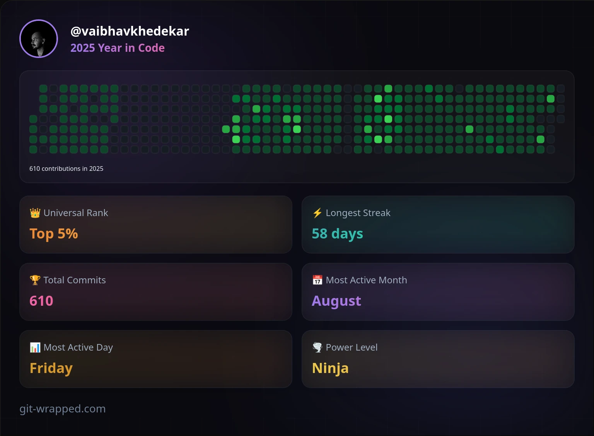

    

    
    
    
    

OR

Drop me Mail on <a href="mailto:contact@vaibhavkhedekar.com">contact@vaibhavkhedekar.com</a>
    | Write message <a href="https://vaibhavkhedekar.com/contact">here</a>

<h3 align="center">Currently working with</h3>

    
    
    

<h3 align="center">Currently learning</h3>

    
    

    <a href="https://github.com/vaibhavkhedekar?tab=repositories">Browse my public repositories</a>
    | <a href="https://vaibhavkhedekar.com">Portfolio</a>

<h3 align="center">My 2025 in code</h3>

    

